

# 🗨️ ShadowLingo

### Luyện nói tiếng Anh theo video, làm riêng cho người Việt

**Thấy cách đọc · Biết mình sai ở đâu · Nhại tới khi giống**

Mở một video tiếng Anh, ShadowLingo hiện ngay bên cạnh với phụ đề Anh–Việt, IPA dưới từng chữ, 
cảnh báo những âm người Việt hay đọc sai, chỗ ghi âm để so với bản gốc, và sổ từ vựng biết nhắc ôn.

[Xem demo](#-xem-shadowlingo-hoạt-động) · [Ảnh chụp](#-ảnh-chụp) · [Tính năng](#-tính-năng) · [Khác biệt](#-vì-sao-chọn-shadowlingo) · [Cài đặt](#-cài-đặt) · [Quyền riêng tư](#-miễn-phí-và-riêng-tư)

 

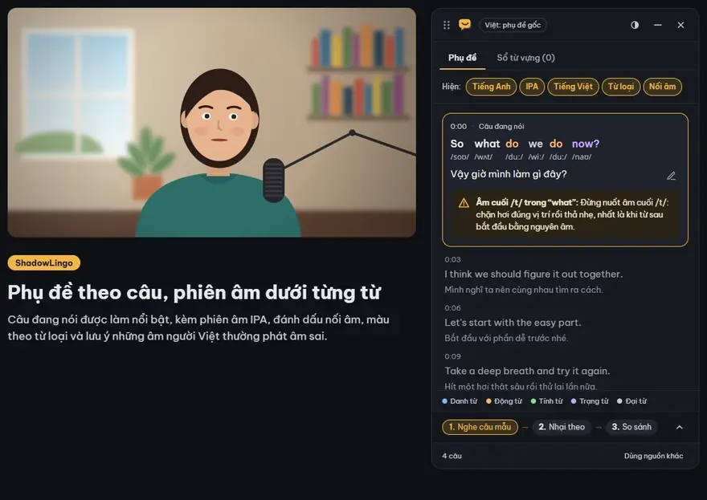

---

## 💡 ShadowLingo giúp bạn điều gì

Nhiều người **biết hết từ trong câu mà vẫn nghe không ra, nói không giống**. Thường không phải do thiếu từ vựng, mà vì:

- Không biết một từ **đọc thế nào** nếu không tra từng chữ.
- Không thấy **nối âm, nuốt âm, âm yếu**, những thứ khiến câu nói thật khác hẳn khi đọc rời từng từ.
- Mắc những lỗi **rất riêng của người Việt**: bỏ âm cuối, đọc /θ/ thành /t/, lẫn /æ/ với /e/, /iː/ với /ɪ/.
- Muốn shadowing phải chuyển qua lại giữa trình phát, từ điển và app ghi âm.

ShadowLingo gom tất cả vào **một khung đặt cạnh video**: nghe câu mẫu, nhìn cách đọc, nhại theo và so sánh ngay tại chỗ.

## 🎬 Xem ShadowLingo hoạt động

**🔍 Bấm một từ để tra, lưu vào sổ một chạm** 
Định nghĩa, ví dụ và cách đọc hiện ngay cạnh video. Nhận ra cả cụm động từ bị tách ra như <i>figure it out</i>.

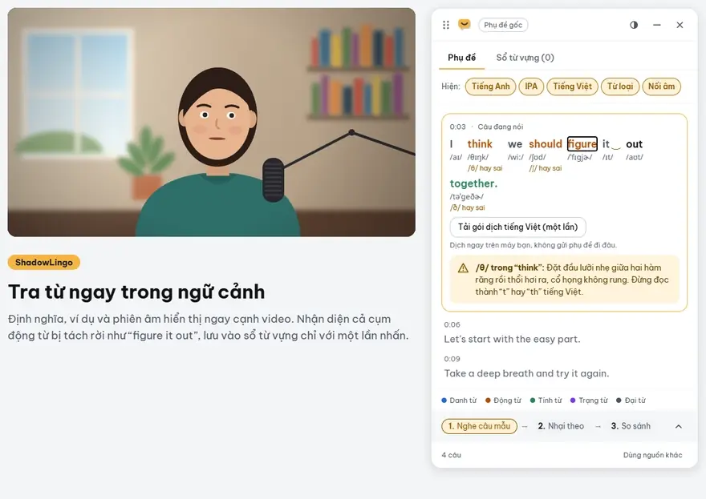

  

**🎙️ Nghe, nhại theo, so sánh** 
Ghi âm giọng bạn ngay trong khung rồi nghe xen kẽ với bản gốc. Bản ghi chỉ nằm trong bộ nhớ, không lưu và không gửi đi đâu.

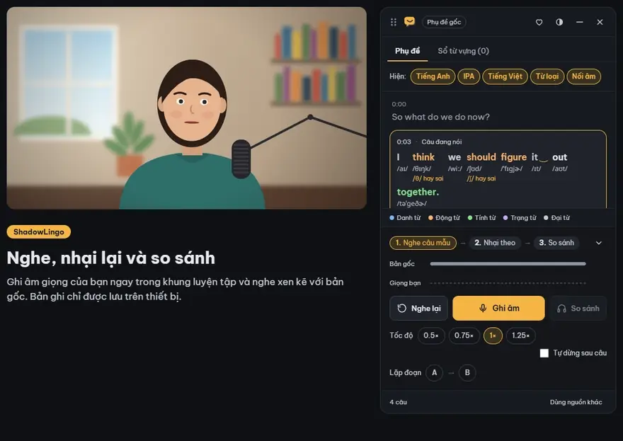

  

**🖼️ Video không có phụ đề? Đọc chữ trên hình** (thử nghiệm) 
Phụ đề in sẵn trên hình được đọc thành từng câu có mốc thời gian, ngay trên máy bạn. ShadowLingo tự tìm chỗ có chữ, hoặc bạn tự chọn vùng.

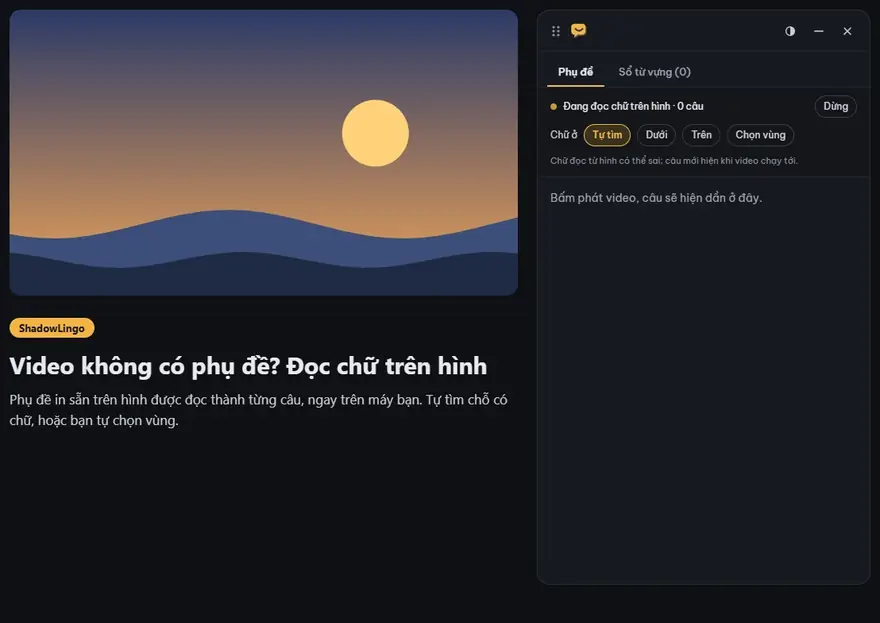

  

**📚 Sổ từ vựng và ôn tập** 
Từ đã lưu kèm câu gốc và mốc thời gian. Ôn bằng câu hỏi trắc nghiệm, lịch ôn tự giãn theo FSRS.

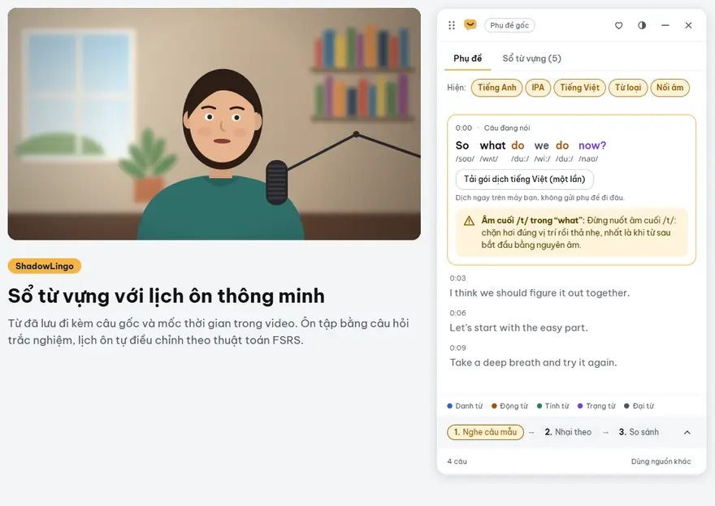

Video trong ảnh là cảnh vẽ minh họa và các câu là câu tự soạn, không lấy từ video nào.

## 📸 Ảnh chụp

| Giao diện tối                                                                                                                                           | Giao diện sáng                                                                                  | Bấm một từ để tra                                                                                                                 |
| ------------------------------------------------------------------------------------------------------------------------------------------------------- | ----------------------------------------------------------------------------------------------- | --------------------------------------------------------------------------------------------------------------------------------- |
| 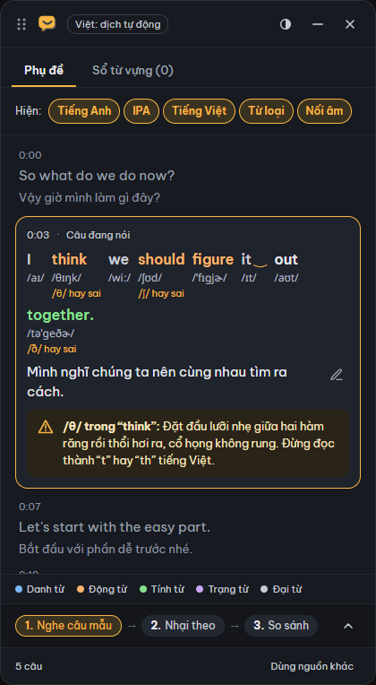 | 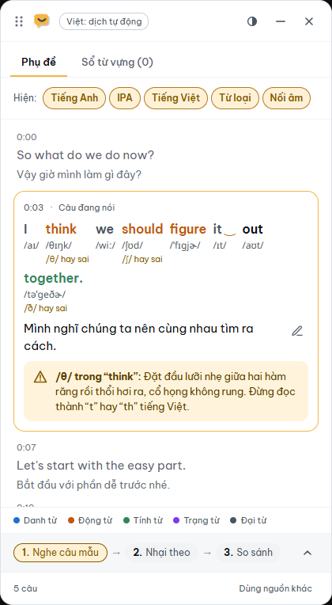 | 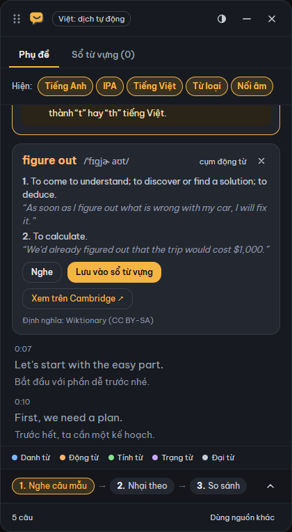 |

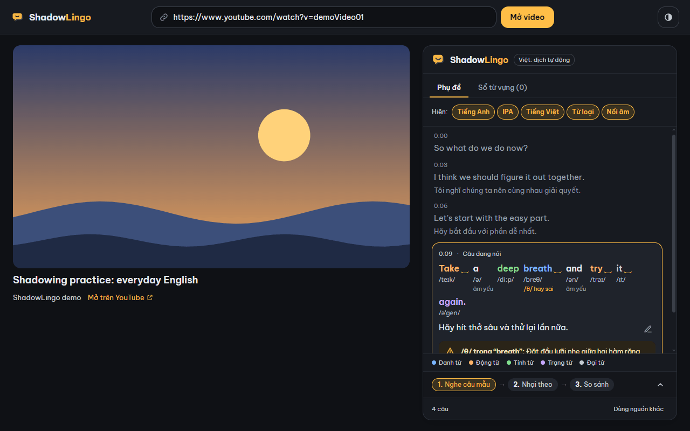

App máy tính (Windows, macOS, Linux): dán link video là học, gói dịch tiếng Việt có sẵn, không cần mạng để dịch.

| App Android                                                                                          | Chọn vùng có chữ trên hình                                                                                                          |
| ---------------------------------------------------------------------------------------------------- | ----------------------------------------------------------------------------------------------------------------------------------- |
| 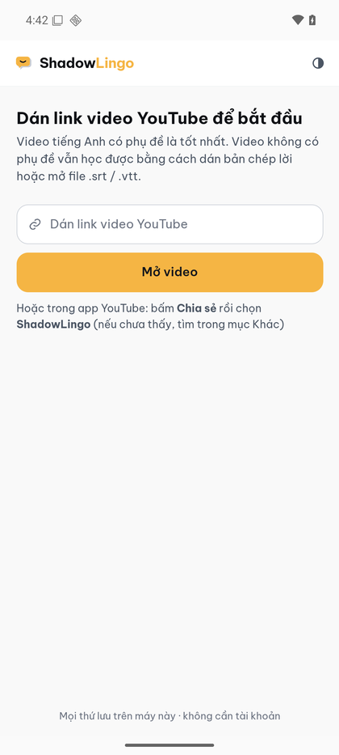 | 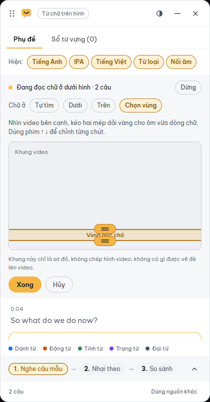 |

Câu ví dụ trong ảnh là câu tự soạn, không lấy từ video nào.

## ✨ Tính năng

### 📝 Phụ đề song ngữ

- Phụ đề tiếng Anh được ghép thành **câu hoàn chỉnh**, kể cả phụ đề tự động vốn hay bị cắt ngang.
- **Dòng tiếng Việt dưới từng câu**: ưu tiên phụ đề Việt do người làm nếu video có (chọn Tiếng Việt ở nút CC một lần); nếu không, dịch ngay trên máy bằng trình dịch có sẵn của Chrome (bản 138 trở lên). Bản máy tính và điện thoại có sẵn gói dịch offline trong bộ cài.
- Luôn ghi rõ nguồn: "Phụ đề gốc", "Dịch tự động" hay "Đã sửa". Bấm biểu tượng bút chì để **sửa bản dịch**, ShadowLingo nhớ bản bạn sửa.
- Câu đang nói tự nổi bật; bấm vào câu nào là nhảy tới đúng đoạn đó.
- Video không có phụ đề? Dán bản chép lời hoặc mở tệp `.srt` / `.vtt`.
- Ở chế độ rạp hát, câu đang nói hiện thành một thanh mỏng ở mép trên video (tự ẩn khi có quảng cáo).

### 🔊 Phát âm cho người Việt

- **IPA dưới từng chữ**, có trọng âm, đọc được cả số, năm và từ viết tắt. Nhìn cả câu là biết cách đọc.
- Đánh dấu **nối âm ‿**, âm bị nuốt và **âm yếu /ə/** của những từ như _to, and, of, can_.
- **Cảnh báo** các âm người Việt hay sai (/θ ð/, âm cuối, /æ/, /iː/–/ɪ/, /ʃ ʒ tʃ dʒ/), kèm **hướng dẫn đặt lưỡi bằng tiếng Việt**.
- **Tô màu theo từ loại** (danh từ, động từ, tính từ, trạng từ, đại từ); những từ như _record_, _present_, _live_ đọc đúng theo vai trò trong câu.
- **Bấm một từ để xem chi tiết**: nghĩa tiếng Việt, IPA, từ loại, định nghĩa và ví dụ (từ Wiktionary, hơn 110.000 từ và cụm từ). Nhận ra cả cụm động từ và thành ngữ, kể cả khi bị tách ra như _figure it out_.

### 🎙️ Luyện shadowing

- Ba bước rõ ràng: **Nghe câu mẫu → Nhại theo → So sánh**.
- Nghe lại đúng một câu, tự dừng sau mỗi câu để kịp nhại, chỉnh tốc độ 0.5× / 0.75× / 1×.
- **Ghi âm giọng bạn** rồi nghe xen kẽ với bản gốc, có dạng sóng để thấy chỗ khác. Bản ghi chỉ nằm trong bộ nhớ, không lưu và không gửi đi đâu.
- Thu gọn phần ghi âm khi muốn dành chỗ cho phụ đề.

### 📚 Sổ từ vựng

- **Lưu từ** ngay từ thẻ chi tiết, kèm IPA, nghĩa, **câu gốc và mốc thời gian**; bấm vào là mở lại đúng đoạn video.
- **Ôn tập trắc nghiệm**: chọn nghĩa đúng trong 4 đáp án. Lịch ôn tự giãn theo thuật toán FSRS: từ nhớ tốt hỏi thưa dần, từ hay quên hỏi lại sớm.
- Tìm từ, lọc theo trạng thái (Cần ôn, Đang học, Đã thuộc) hoặc theo video đang xem; theo dõi chuỗi ngày ôn và số lượt ôn trong tuần.
- Xuất sang **Anki** hoặc **CSV**; **sao lưu và khôi phục** cả sổ bằng một tệp để chuyển sang máy khác.

### ⌨️ Phím tắt

|                    Phím                     | Tác dụng                                   |
| :-----------------------------------------: | ------------------------------------------ |
|                <kbd>S</kbd>                 | Nghe lại câu                               |
|                <kbd>R</kbd>                 | Ghi âm / dừng ghi                          |
|                <kbd>C</kbd>                 | So sánh với bản gốc                        |
|         <kbd>↑</kbd> / <kbd>↓</kbd>         | Câu trước / câu sau                        |
|              <kbd>Space</kbd>               | Phát / tạm dừng video                      |
|         <kbd>I</kbd> / <kbd>L</kbd>         | Bật/tắt IPA / nối âm                       |
|               <kbd>Esc</kbd>                | Đóng thẻ chi tiết từ                       |
| <kbd>1</kbd>–<kbd>4</kbd>, <kbd>Space</kbd> | Khi ôn tập: chọn đáp án, sang từ tiếp theo |

### 🖥️ Dùng ở đâu

- **Extension** cho Chrome và Edge trên máy tính, chạy ngay trên trang xem video.
- Giao diện **hoàn toàn tiếng Việt**; sáng hay tối tự theo trang, hoặc bạn tự chọn bằng nút ◐ trên đầu khung.

### 🚧 Sắp có

Đã làm xong, có trong bản phát hành tới:

- **Lặp đoạn A–B** và tốc độ **1.25×** khi luyện shadowing.
- **Đọc chữ trên hình** (thử nghiệm) cho video không có phụ đề mà chữ in sẵn trên hình: ShadowLingo tự tìm chỗ có chữ (hoặc bạn tự chọn vùng) và đọc thành từng câu có mốc thời gian. Đọc ngay trên máy, không gửi hình đi đâu; câu đã đọc được giữ lại trên máy, mở lại video là có ngay. Có trên extension, app máy tính và app Android.

Đang làm:

- **App cho Windows, macOS, Linux và Android**: dán link video để học; trên Android còn chia sẻ thẳng từ app YouTube. Bản **iPhone/iPad** đang hoàn thiện.
- Đọc chữ trên hình trong app iPhone/iPad.

## 🏆 Vì sao chọn ShadowLingo

|                                              | ShadowLingo | Tiện ích phụ đề song ngữ quốc tế | App shadowing trên điện thoại |
| -------------------------------------------- | :---------: | :------------------------------: | :---------------------------: |
| IPA hiện sẵn dưới từng chữ                   |     ✅      |                ❌                |            Tùy app            |
| Cảnh báo lỗi phát âm riêng của người Việt    |     ✅      |                ❌                |              ❌               |
| Đánh dấu nối âm, âm yếu                      |     ✅      |                ❌                |              ❌               |
| Ghi âm và so sánh ngay cạnh video            |     ✅      |                ❌                |              ✅               |
| Chạy ngay trên trang video trong trình duyệt |     ✅      |                ✅                |              ❌               |
| Giao diện hoàn toàn tiếng Việt               |     ✅      |                ❌                |            Tùy app            |
| Miễn phí 100%, không cần tài khoản           |     ✅      |          Có gói trả phí          |        Có gói trả phí         |
| Mã nguồn mở                                  |     ✅      |                ❌                |              ❌               |
| Chạy được trên Linux                         |     ✅      |                ✅                |              ❌               |

## 📥 Cài đặt

Trong lúc chờ lên Chrome Web Store, bạn có thể cài trực tiếp (Chrome hoặc Edge):

1. Vào trang [Releases](https://github.com/hoangtularva/shadow-lingo/releases/latest), tải tệp `shadowlingo-…-chrome-edge.zip`.
2. Giải nén vào một thư mục cố định, và đừng xóa thư mục này sau khi cài.
3. Mở `chrome://extensions` (hoặc `edge://extensions` trên Edge), bật **Chế độ dành cho nhà phát triển**.
4. Bấm **Tải tiện ích đã giải nén** rồi chọn thư mục vừa giải nén.
5. Mở một video YouTube có phụ đề tiếng Anh và bật nút CC: ShadowLingo hiện ngay bên cạnh.

**Cập nhật:** tải tệp zip mới, giải nén đè vào thư mục cũ, rồi bấm nút tải lại (↻) của ShadowLingo ở trang tiện ích.

## 🔒 Miễn phí và riêng tư

- **Miễn phí 100%**: không quảng cáo, không gói trả phí, không cần tài khoản.
- **Dữ liệu không rời máy bạn**: dịch, cách đọc, từ điển, ghi âm và sổ từ đều xử lý và lưu ngay trên máy. Không có máy chủ nào nhận dữ liệu của bạn. (Lần đầu bật tiếng Việt trên Chrome, trình duyệt tự tải gói dịch của nó một lần.)
- **Không theo dõi**: không analytics, không thu thập gì. Gỡ extension là dữ liệu của nó trên máy cũng được xóa.
- **Quyền tối thiểu**: extension chỉ xin quyền trên trang xem video.
- **Mã nguồn mở**: ai cũng kiểm chứng được những điều trên.

Phát hiện lỗ hổng bảo mật? Xem [SECURITY.md](SECURITY.md).

## ⚖️ Lưu ý

- ShadowLingo không tải video hay âm thanh về máy, không chặn hay ẩn quảng cáo, không can thiệp vào trình phát.
- Dữ liệu phát âm, từ điển và mô hình dịch đều có giấy phép mở (Wiktionary, CMU Pronouncing Dictionary, OPUS-MT), ghi công đầy đủ trong [THIRD_PARTY_NOTICES.md](THIRD_PARTY_NOTICES.md).
- ShadowLingo là dự án độc lập, không liên kết với Google, YouTube, Cambridge hay Oxford.

## 📄 Giấy phép

Mã nguồn phát hành theo [GPL-3.0](LICENSE). Tên **ShadowLingo** và logo không nằm trong giấy phép này; bản fork vui lòng dùng tên và logo khác.

 
Làm bằng ❤️ cho người Việt học tiếng Anh.

