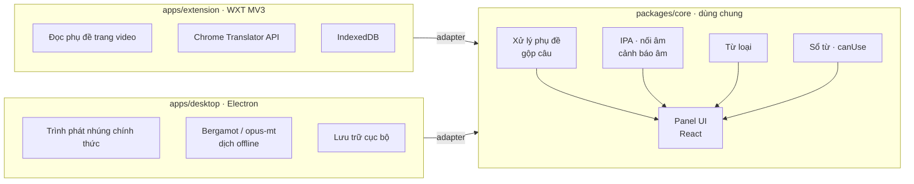

<div align="center">

# 🗨️ ShadowLingo

### Công cụ shadowing tiếng Anh làm riêng cho người Việt

**Thấy cách đọc · Biết mình sai ở đâu · Nhại cho tới khi giống**

[](LICENSE)
[](#-lộ-trình)
[](#-miễn-phí-100-và-riêng-tư-tuyệt-đối)
[](#-bảo-mật--quyền-riêng-tư)


Extension Chrome/Edge chạy ngay trên trang video, kèm app máy tính cho Windows, macOS và Linux.<br>
Phụ đề Anh–Việt song song · IPA dưới từng chữ · Cảnh báo lỗi phát âm của người Việt · Ghi âm & so sánh.

[Tính năng](#-tính-năng) · [Vì sao khác biệt](#-vì-sao-shadowlingo-khác-biệt) · [Kiến trúc](#-kiến-trúc) · [Lộ trình](#-lộ-trình) · [Đóng góp](#-đóng-góp)

</div>

---

> [!NOTE]
> ShadowLingo đang ở giai đoạn phát triển ban đầu. Các tính năng bên dưới là phạm vi đã thiết kế; trạng thái từng phần xem ở [Lộ trình](#-lộ-trình). Hãy ⭐ repo để theo dõi bản phát hành đầu tiên.

## 💡 Vấn đề

Người Việt học tiếng Anh thường **biết hết từ trong câu mà vẫn nghe không ra, nói không giống**. Nguyên nhân hiếm khi là từ vựng, mà là:

- Không biết từ đó **đọc thế nào** cho tới khi bấm tra từng chữ.
- Không thấy **nối âm, nuốt âm, âm yếu**, thứ làm câu nói thật khác hẳn từng từ ghép lại.
- Mắc những lỗi **rất riêng của người Việt**: bỏ âm cuối, đọc /θ/ thành /t/, lẫn /æ/ với /e/, /iː/ với /ɪ/, mà công cụ quốc tế không hề chỉ ra.
- Shadowing phải chuyển qua lại giữa trình phát, từ điển và app ghi âm.

**ShadowLingo gom tất cả vào một panel đặt cạnh video**, để bạn nghe, nhìn cách đọc, nhại theo và so sánh mà không rời trang.

## ✨ Tính năng

### 📝 Phụ đề thông minh
- Phụ đề tiếng Anh theo **câu hoàn chỉnh**: tự gộp các mẩu phụ đề tự động bị cắt giữa chừng.
- **Bản dịch tiếng Việt song song**, ưu tiên phụ đề Việt do người làm, nếu không có thì dịch ngay trên máy bằng Translator API có sẵn trong Chrome.
- Ghi rõ nguồn ("Phụ đề gốc" / "Dịch tự động"); bạn **sửa được bản dịch** và tool nhớ bản đã sửa.
- Câu đang nói tự làm nổi bật và cuộn tới; bấm câu bất kỳ để nhảy tới.
- Video không có phụ đề: dán transcript, mở file `.srt` / `.vtt`, hoặc đọc chữ in trên hình bằng OCR (thử nghiệm).

### 🔊 Phát âm cho người Việt
- **IPA dưới từng chữ**, canh thẳng cột, có trọng âm `ˈ ˌ`. Nhìn cả câu là biết cách đọc.
- Đánh dấu **nối âm ‿**, **âm yếu /ə/** của các từ chức năng (*to, and, of, can…*).
- **Cờ cảnh báo** những âm người Việt hay sai, kèm **hướng dẫn đặt lưỡi bằng tiếng Việt**.
- Bấm một từ để nghe đọc mẫu, xem nghĩa theo ngữ cảnh, từ loại, gia đình từ, định nghĩa và ví dụ.
- **Từ điển phrasal verbs & thành ngữ** soạn tay, nghĩa Việt chuẩn, đúng ở chỗ dịch máy hay sai nhất.

### 🎙️ Shadowing
- Quy trình 3 bước: **Nghe câu mẫu → Nhại theo → So sánh**.
- Lặp câu, lặp đoạn A–B, tự dừng sau mỗi câu, tốc độ 0.5× – 1.25×.
- **Ghi âm giọng bạn** và phát xen kẽ với bản gốc, kèm dạng sóng hai bên.
- **Tô màu từ loại** (danh từ, động từ, tính từ, trạng từ) để vừa nhại vừa hiểu cấu trúc câu.

### 📚 Sổ từ vựng
- Lưu từ kèm IPA, nghĩa, **câu gốc và mốc thời gian**; bấm là mở lại đúng đoạn video.
- Ôn tập lặp lại ngắt quãng, xuất **Anki / CSV**.
- Thống kê phút shadowing, số câu đã nhại, chuỗi ngày học.

### ⌨️ Dùng hoàn toàn bằng bàn phím

| Phím | Tác dụng |
| :---: | --- |
| <kbd>S</kbd> | Nghe lại câu |
| <kbd>R</kbd> | Ghi âm |
| <kbd>C</kbd> | So sánh với bản gốc |
| <kbd>A</kbd> / <kbd>D</kbd> | Câu trước / câu sau |
| <kbd>V</kbd> | Lưu từ đang trỏ |

## 🏆 Vì sao ShadowLingo khác biệt

| | ShadowLingo | Tool phụ đề song ngữ quốc tế | App shadowing trên điện thoại |
| --- | :---: | :---: | :---: |
| IPA hiện sẵn dưới từng chữ | ✅ | ❌ | Tùy app |
| Cảnh báo lỗi phát âm riêng của người Việt | ✅ | ❌ | ❌ |
| Đánh dấu nối âm, âm yếu | ✅ | ❌ | ❌ |
| Ghi âm & so sánh ngay cạnh video | ✅ | ❌ | ✅ |
| Chạy ngay trên trang video trong trình duyệt | ✅ | ✅ | ❌ |
| Giao diện hoàn toàn tiếng Việt | ✅ | ❌ | Tùy app |
| Miễn phí 100%, không tài khoản | ✅ | Có gói trả phí | Có gói trả phí |
| Mã nguồn mở | ✅ | ❌ | ❌ |
| Hỗ trợ Linux | ✅ | ✅ | ❌ |

## 🔒 Bảo mật & quyền riêng tư

**Nguyên tắc số 1: dữ liệu không thu thập thì không thể bị lộ.**

- **Không có server.** Dịch, IPA, từ loại, OCR, ghi âm và lưu trữ đều chạy trên máy bạn.
- **Không tài khoản, không analytics, không quảng cáo.** Sổ từ và bản ghi âm nằm trong trình duyệt của bạn, có nút xóa toàn bộ.
- **Quyền tối thiểu:** extension chỉ xin quyền trên trang video, không tải code từ xa, không dùng `innerHTML` hay `eval`, phụ đề luôn hiển thị dạng văn bản để chống chèn mã.
- **Mã nguồn mở:** ai cũng kiểm tra được những lời hứa trên.

Phát hiện lỗ hổng? Xem [SECURITY.md](SECURITY.md) để báo cáo riêng.

## 💸 Miễn phí 100% và riêng tư tuyệt đối

| Thành phần | Chạy bằng | Chi phí |
| --- | --- | :---: |
| Dịch Anh → Việt | Translator API có sẵn trong Chrome (trên máy) | 0đ |
| IPA & trọng âm | CMU Pronouncing Dictionary + Wiktionary, đóng gói sẵn | 0đ |
| Từ loại | Thư viện NLP chạy trong trình duyệt | 0đ |
| Đọc mẫu | Web Speech API | 0đ |
| OCR | Tesseract.js, chạy trên máy | 0đ |
| Lưu trữ | IndexedDB trên máy | 0đ |

## 🏗️ Kiến trúc

Một lõi code, hai sản phẩm. Mọi thứ khác nhau giữa các nền tảng đi qua **adapter**.



```
shadow-lingo/
├── packages/core      # phụ đề, IPA, từ loại, sổ từ, canUse, panel UI
├── apps/extension     # Chrome / Edge (WXT, Manifest V3)
├── apps/desktop       # Windows · macOS · Linux (Electron)
└── apps/web           # trang giới thiệu (Next.js, xuất tĩnh)
```

**Công nghệ:** TypeScript (strict) · React · Tailwind CSS (Shadow DOM) · Zustand · Dexie · WXT · Electron · Vitest · Playwright · pnpm workspaces · GitHub Actions.

## 🗺️ Lộ trình

- [ ] **Phase 1 — Nền móng:** monorepo, CI, panel kéo thả, phụ đề theo câu đồng bộ với video
- [ ] **Phase 2 — Song ngữ & IPA:** dịch trên máy, IPA dưới từng chữ, thẻ tra từ, từ điển cụm từ
- [ ] **Phase 3 — Shadowing:** lặp câu, ghi âm & so sánh, tô từ loại, nối âm, cảnh báo âm cho người Việt
- [ ] **Phase 4 — Sổ từ vựng:** lưu từ theo ngữ cảnh, ôn tập ngắt quãng, xuất Anki/CSV, thống kê
- [ ] **Phase 5 — Hoàn thiện:** rà soát bảo mật, OCR thử nghiệm, tối ưu cho máy yếu
- [ ] **Phase 6 — Phát hành:** Chrome Web Store, Edge Add-ons, trang giới thiệu
- [ ] **Phase 7 — App máy tính:** Windows, macOS (Intel & Apple Silicon), Linux (.AppImage, .deb)

## 🛠️ Phát triển

> Yêu cầu: Node.js 20+, pnpm 9+, Chrome 138+ hoặc Edge bản máy tính.

```bash
git clone https://github.com/hoangtularva/shadow-lingo.git
cd shadow-lingo
pnpm install
pnpm dev        # chạy extension với hot reload
pnpm test       # unit test
pnpm e2e        # end-to-end test
pnpm lint && pnpm typecheck
```

Các lệnh trên sẽ dùng được từ Phase 1.

## 🤝 Đóng góp

Mọi đóng góp đều được chào đón: báo lỗi, đề xuất tính năng, bổ sung từ điển cụm từ, cải thiện hướng dẫn phát âm, hay gửi code.

1. Fork repo và tạo nhánh từ `master`.
2. Commit theo [Conventional Commits](https://www.conventionalcommits.org/) (`feat:`, `fix:`, `docs:`…).
3. Mở Pull Request; CI phải xanh trước khi merge.

## ⚖️ Pháp lý

- Không tải video hay âm thanh; không lưu hay gửi phụ đề đi đâu; không chặn hay ẩn quảng cáo và giao diện trình phát.
- Chỉ dùng dữ liệu giấy phép mở (Wiktionary CC BY-SA, CMU Dict, opus-mt Apache 2.0, font OFL), ghi công trong `THIRD_PARTY_NOTICES.md`.
- ShadowLingo là dự án độc lập, không liên kết với Google, YouTube, Cambridge hay Oxford. Nút "Xem trên Cambridge" chỉ là đường link.

## 📄 Giấy phép

Mã nguồn phát hành theo [GPL-3.0](LICENSE). Dữ liệu trong `data/` giữ giấy phép riêng của từng nguồn.

Tên **ShadowLingo** và logo không đi kèm giấy phép trên; bản fork vui lòng dùng tên và logo khác.

<div align="center">
<br>
<sub>Làm bằng ❤️ cho người Việt học tiếng Anh.</sub>
</div>
